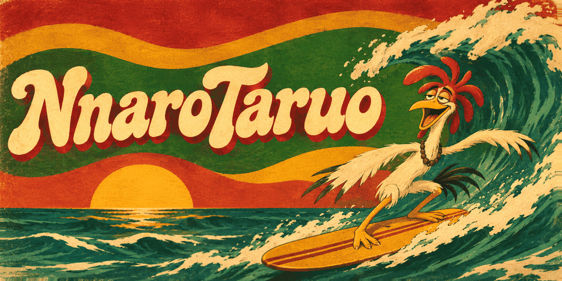

  

<h1 align="center">Hi, I’m Ronan Antoque 🇵🇭</h1>

  <strong>Aspiring AI Software Engineer · Web and Mobile Developer · IoT Hobbyist</strong>

  4th-year BSIT student at <strong>UC Main</strong> • Online as <strong>NnaroTaruo</strong> 
  Learning to build useful web and mobile applications with AI-powered features. 
  Exploring software engineering, AI integration, and IoT projects.

---

### 💻 Tech Stack

| Category | Technologies |
|---|---|
| **Frontend** | HTML, CSS, JavaScript, Tailwind CSS |
| **Backend** | PHP, Laravel, REST APIs, C# and .NET *(currently learning)* |
| **Languages I'm Learning** | Ruby, Go (Golang) |
| **Databases** | MySQL,  MongoDB *(currently learning)* |
| **Mobile** | React Native |
| **Tools** | Git, GitHub, VS Code |
| **Design** | Figma, Framer |

### 🤖 AI Tools

<table>
  <tr>
    <td align="center">
       
      <strong>Codex</strong>
    </td>
    <td align="center">
       
      <strong>Claude</strong>
    </td>
    <td align="center">
       
      <strong>Gemini</strong>
    </td>
    <td align="center">
       
      <strong>Antigravity</strong>
    </td>
    <td align="center">
       
      <strong>Kiro AI</strong>
    </td>
  </tr>
</table>

### 🌱 Currently Learning

- Software engineering fundamentals, testing, and debugging
- C# and .NET for backend development
- MongoDB for NoSQL database design and development
- Ruby fundamentals and object-oriented programming
- Go (Golang) fundamentals and backend development
- Full-stack development with Laravel and React Native
- AI integration through APIs and workflow automation
- IoT and embedded systems through hands-on projects

---

  <em>Understand the code. Build with purpose. Keep learning.</em>

